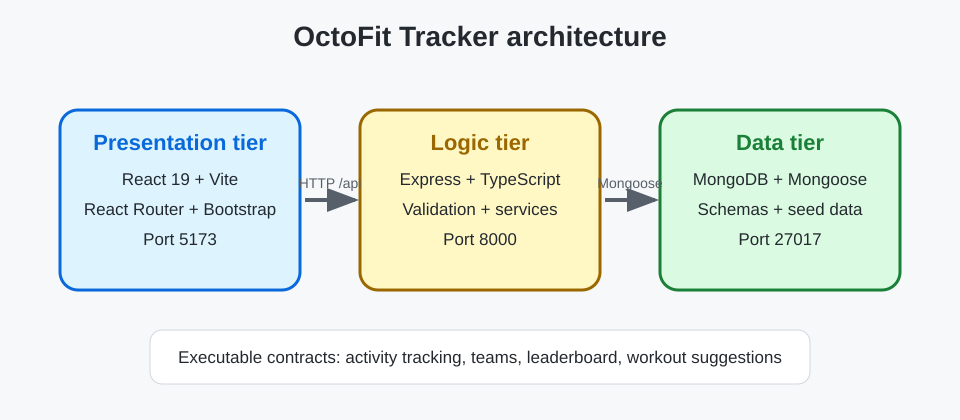

# OctoFit Tracker architecture

OctoFit Tracker is a three-tier application for a school fitness program. The starter code includes API contracts and intentionally incomplete implementation points so you can use GitHub Copilot agent mode in a test-driven loop.

## Tier boundaries

- **Presentation tier**: React 19, Vite, React Router, Bootstrap, and a shared API client in `octofit-tracker/frontend/src`.
- **Logic tier**: Express and TypeScript routes/services in `octofit-tracker/backend/src` expose `/api/*` behavior on port `8000`.
- **Data tier**: Mongoose models and seed data in `octofit-tracker/backend/src/models` and `src/scripts/seed.ts` persist to MongoDB on port `27017`.

## Ports and environment rules

- MongoDB: `27017`
- Express API: `8000`
- Vite frontend: `5173`
- The browser calls relative `/api` paths. Vite proxies them to `http://localhost:8000`, so the unauthenticated API port stays private in Codespaces. `VITE_API_BASE_URL` can override the base URL.

## API contract

| Capability | Method and path | Expected behavior |
| --- | --- | --- |
| Activity tracking | `GET /api/activities`, `POST /api/activities` | List and create valid activity records. POST accepts `userId`, `teamId`, `type`, and `minutes`; `userId` and `teamId` must be well-formed IDs for an existing user and team; otherwise respond with a deliberate 4xx (never a 500 from a cast error). A created activity stores the submitted `user`, `team`, `type`, and `minutes` plus computed `points` and `occurredAt`. |
| Teams | `GET /api/teams`, `POST /api/teams` | List and create teams with members. Created and listed teams keep the submitted `name` and `mascot`. Reject a team without a name with `400`. |
| Leaderboard | `GET /api/leaderboard` | Return teams ordered by the sum of their activity points, highest first. Each entry has `teamName`, `totalPoints`, and a 1-based `rank`. |
| Workout suggestions | `GET /api/workouts/suggestions/:userEmail` | Recommend workouts from recent activity patterns for the matching seeded user's email address. The first suggestion's `focus` matches that user's goal or recent activity, with a `reason` explaining why. An email with no matching user returns a deliberate 4xx (for example, `404`). |

## Implementation decisions

Record your plan here before editing code.

- Presentation tier decision: Keep route-specific rendering and interaction in React components, use the shared API client for requests, and expose loading, empty, and error states accessibly. Keep persistence and domain calculations out of the UI.
- Logic tier decision: Keep HTTP parsing, validation, status codes, and response envelopes in Express routes; delegate domain operations to `octofitService`. Return deliberate 4xx responses for invalid or missing resources.
- Data tier decision: Express relationships and required values in Mongoose schemas, default collection-like fields such as team members to empty arrays, and keep seeding repeatable without deleting unrelated records.
- Activity tracking approach: Validate ID shape and that the referenced user and team exist before saving. Persist the submitted user, team, type, and minutes, and compute points and `occurredAt` on the server.
- Team management approach: Reject a missing team name with `400`, preserve submitted names and mascots, and store member references with an empty-array default.
- Leaderboard approach: Sum activity points by team, sort from highest total to lowest, and assign each returned entry a 1-based rank.
- Workout suggestions approach: Find the user by email, select suggestions aligned with their fitness goal or recent activity, include a reason for the leading suggestion, and return a deliberate 4xx when no user matches.

## Test plan

Record the commands you run and what each failure means.

- Data tier: `npm run test:data --prefix octofit-tracker/backend` checks required model fields, defaults, references, and repeatable seed behavior. Failures point to schemas or seed logic.
- API: `npm run test:api --prefix octofit-tracker/backend` checks request validation, persistence, response shapes, leaderboard ordering, and workout recommendations. Failures point to route or service behavior, or its data-tier dependencies.
- Frontend: `npm test --prefix octofit-tracker/frontend` checks API-backed rendering, user-specific requests, and accessible loading, empty, and error states. Failures point to the API client or presentation components.
- Backend build: `npm run build --prefix octofit-tracker/backend` type-checks backend code; failures indicate TypeScript or backend contract mismatches.
- Frontend build: `npm run build --prefix octofit-tracker/frontend` type-checks and bundles the UI; failures indicate TypeScript, module, or Vite build issues.

Baseline from the initial test run: the backend suite had 8 failures and 1 pass (the seed idempotency test); the frontend suite had 15 failures. Run the focused commands above to localize these failures before proceeding to builds.
